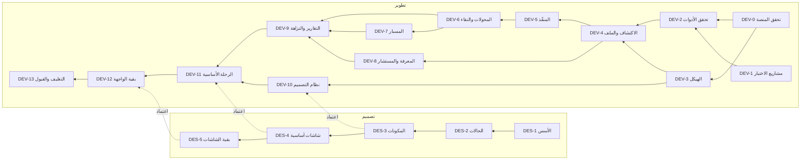

# فهرس المراحل وموجّه الأوامر

**19 مرحلة في مسارين:** 14 مرحلة تطوير (DEV-0 إلى DEV-13) و5 مراحل تصميم (DES-1 إلى DES-5). سبب التقسيم في [قرار التنظيم ORG-02](../tracking/decisions.md). وتُشغَّل في **موجات متوازية** مرجعها الوحيد [docs/waves/README.md](../waves/README.md). والحالة الحية لكل مرحلة تعرضها [صفحة المراحل](../dashboard/README.md).

## 1. الموجّه

| ما يرسله المالك | أين | الملف الذي يُفتح |
|---|---|---|
| «ابدأ الموجة X» | جلسة التنسيق على المجلد الأصلي | [docs/waves/README.md](../waves/README.md)، القسم 6 |
| «ابدأ مرحلة التطوير N» أو «تابع مرحلة التطوير N» | جلسة على `AYAR-wt/DEV-N` | `dev/DEV-NN-*.md` (N بخانتين، مثل `DEV-03`) |
| «ابدأ مرحلة التصميم N» أو «تابع مرحلة التصميم N» | جلسة على `AYAR-wt/DES-N` | `design/DES-N-*.md` |
| «ما الحالة؟» | أي جلسة | صفحة المراحل، أو `build.mjs --check` وآخر [سجل التقدم](../tracking/progress.md) |
| «ابدأ المرحلة N» دون مسار | — | اسأل: تصميم أم تطوير؟ |

ثم يتبع منفّذ المرحلة بروتوكول [AGENTS.md القسم 3](../../AGENTS.md): التحقق من الحالة الفعلية، ثم التنفيذ، ثم بوابة الفحص، ثم التسليم والتوقف. والدمج والإغلاق لجلسة التنسيق.

## 2. مسار التطوير

| المرحلة | العنوان | تعتمد على | تنتظر تصميمًا | تنتظر المالك | الملف |
|---|---|---|---|---|---|
| DEV-0 | التحقق السابق للبناء: المنصة والغلاف والتخزين | — | — | A-03، A-11، A-13، A-14 (أثناءها) | [DEV-00](dev/DEV-00-platform-verification.md) |
| DEV-1 | مشاريع الاختبار ذات العيوب المزروعة | — | — | — | [DEV-01](dev/DEV-01-fixtures.md) |
| DEV-2 | التحقق السابق للبناء: الأدوات والعمليات والمستودعات | DEV-0، DEV-1 | — | E-15، E-17 (أثناءها) | [DEV-02](dev/DEV-02-tools-verification.md) |
| DEV-3 | الهيكل والبروتوكول والغلاف الآمن والتخزين | DEV-0 | — | **Q-04 قبل البدء** | [DEV-03](dev/DEV-03-skeleton.md) |
| DEV-4 | الكتالوج والإخفاء والمشاريع والاكتشاف والبيئة والملف | DEV-2، DEV-3 | — | — | [DEV-04](dev/DEV-04-discovery-profile.md) |
| DEV-5 | المخطِّط ومدير الأدوات والمنفّذ والأدلة | DEV-4 | — | — | [DEV-05](dev/DEV-05-planner-executor.md) |
| DEV-6 | المحوّلات والمحلّلات والمصنّف ومؤشر النقاء | DEV-5 | — | Q-05 (أثناءها) | [DEV-06](dev/DEV-06-adapters-classifier.md) |
| DEV-7 | مسبار الويب وفحوص العرض الحي | DEV-6 | — | — | [DEV-07](dev/DEV-07-web-probe.md) |
| DEV-8 | قاعدة المعرفة والمستشار وقوالب البطاقات | DEV-4 | — | — | [DEV-08](dev/DEV-08-knowledge-advisor.md) |
| DEV-9 | التقارير والنزاهة وفحوص النموذج والتصدير | DEV-6، DEV-7، DEV-8 | — | **Q-03 قبل البدء**، Q-06 (أثناءها) | [DEV-09](dev/DEV-09-reports-integrity.md) |
| DEV-10 | نظام التصميم في الشيفرة | DEV-3 | **DES-1، DES-2، DES-3** | — | [DEV-10](dev/DEV-10-design-system-code.md) |
| DEV-11 | واجهة الرحلة الأساسية | DEV-9، DEV-10 | **DES-4** | — | [DEV-11](dev/DEV-11-core-journey-ui.md) |
| DEV-12 | بقية الواجهة | DEV-11 | **DES-5** | — | [DEV-12](dev/DEV-12-remaining-ui.md) |
| DEV-13 | التغليف والتوقيع والمعايرة والقبول النهائي | DEV-12 | — | Q-07 (أثناءها) | [DEV-13](dev/DEV-13-packaging-acceptance.md) |

## 3. مسار التصميم

| المرحلة | العنوان | تعتمد على | تفتح للتطوير | الملف |
|---|---|---|---|---|
| DES-1 | تنظيم الملف وإكمال الهوية والأسس | الهوية المعتمدة (D-48) | DEV-10 (مع DES-2 وDES-3) | [DES-1](design/DES-1-foundations.md) |
| DES-2 | نظام الحالات ورموزه ودائرة العيار | DES-1 | DEV-10 | [DES-2](design/DES-2-status-icons.md) |
| DES-3 | المكونات التسعة والعشرون | DES-2 | DEV-10 | [DES-3](design/DES-3-components.md) |
| DES-4 | شاشات الرحلة الأساسية (1–8) | DES-3 | DEV-11 | [DES-4](design/DES-4-core-screens.md) |
| DES-5 | بقية الشاشات والرحلات والإرشادات | DES-4 | DEV-12 | [DES-5](design/DES-5-remaining-screens-flows.md) |

كل مرحلة تصميم تُغلق باعتماد صريح من المالك ([docs/design/README.md](../design/README.md)).

## 4. مخطط التبعيات

## 5. ما يسير بالتوازي

الموجات وشروط بدئها وإغلاقها، ومجلد كل مرحلة وفرعها، والنموذج المقترح لها، في [docs/waves/README.md](../waves/README.md). وهي مشتقة من التبعيات أعلاه، والمولّد يرفض أي موجة تضع مرحلة مع ما تعتمد عليه.

## 6. الحالات

| القيمة في الواجهة | المعنى |
|---|---|
| `not-started` | لم تبدأ |
| `in-progress` | جارية |
| `awaiting-owner` | بانتظار قرار أو اعتماد من المالك |
| `blocked` | معطّلة بسبب مثبت في ملف تسليمها، ثم في [blockers.md](../tracking/blockers.md) |
| `delivered` | سلّمها منفّذها بملف `docs/handoffs/<ID>.md`، وتنتظر دمج جلسة التنسيق |
| `closed` | دمجتها جلسة التنسيق بعد التحقق، ولها وسم `<ID>-closed` |

وحالات تحسبها الصفحة ولا تُكتب: «مجهّزة» (لها مجلد وفرع ولم تبدأ)، و«متاحة» (تبعياتها مغلقة وقرارات بدئها محسومة، وتنتظر أمر الموجة لتجهيزها)، و«تنتظر قرارك» و«تنتظر تصميمًا معتمدًا» و«تنتظر مرحلة سابقة».

## 7. هيكل ملف المرحلة

كل ملف يبدأ بواجهة YAML تقرؤها صفحة المراحل، ثم أقسام ثابتة: الهدف، ومتطلبات البدء، والقراءات الضرورية بأقسامها وأسطرها، والسياق الملزم، والمهام، والمخرجات، والفحوص، ومعايير الإغلاق، وما لا يدخل المرحلة، وبرومبت التنفيذ، وحالة التقدم ونقطة الاستئناف.

**حقول الواجهة:** `id`، و`track` (`dev` أو `design`)، و`number`، و`stage` (مجموعة العرض: `design` أو `verification` أو `engine` أو `interface` أو `release`)، و`title`، و`status`، و`status_date`، و`depends_on`، و`design_gates`، و`owner_gates` (قبل البدء)، و`owner_inputs` (أثناء المرحلة)، و`model` و`effort` و`model_reason` (اقتراح التشغيل)، و`scope` (مسارات الكتابة)، و`goal`، و`start`، و`outputs`، و`closing_commit`. منفّذ المرحلة يحدّث `status` و`status_date` فقط، والمنسّق `closing_commit` والإغلاق، ولا يتغير الباقي إلا بقرار مسجل.
